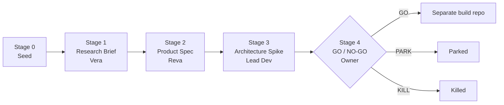

# ccode-pipeline

A multi-agent AI development pipeline that takes an idea from a one-line seed to a GO / NO-GO
decision, with least-privilege agents, a human approval gate on every irreversible step, and an
adversarial reviewer whose only job is to break the output.

It is built on Claude Code subagents, and it applies agentic AI guardrails to a real working
system rather than describing them in the abstract.

## The problem

Doing serious security engineering as a single operator is a coordination problem. Research does not
feed specs, specs do not feed architecture, and context is lost between AI sessions. Giving one
general-purpose agent broad access to do all of it is fast, and it is also the agentic-AI
failure mode the security field worries about most: a highly privileged actor with no separation
of duties and no checkpoint before it acts.

## How it works

Every idea runs through five stages. Nothing advances without a written artifact, and only the
owner can approve the final gate.



| Stage | Artifact | Produced by |
|---|---|---|
| 0: Seed | `seeds/*.md`, 1 to 3 raw sentences | Owner (desktop, or mobile via a routine) |
| 1: Research Brief | `research/brief.md` | Vera |
| 2: Product Spec | `spec/product.md` | Reva |
| 3: Architecture Spike | `architecture/spike.md` | Lead Dev |
| 4: Gate Review | `decisions/gate-review.md` | Owner only |

This repo is its own first exploration, so the Stage 1 to 3 artifacts above are filled in for
the pipeline itself.

## Security controls

| Control | Where it lives |
|---|---|
| **Per-agent least privilege.** Each agent gets an explicit tool allowlist. The reviewers (Dani, Felix) are read-only and cannot write files. Only the agents that produce a stage artifact can write. | `.claude/agents/*.md` (`tools:` frontmatter) |
| **Separation of duties.** Research, spec, architecture and the go decision are held by different roles. No agent decides GO / PARK / KILL. | `DESIGN.md` → Three-Layer Architecture |
| **Human approval gate.** The owner approves every stage gate. Agent content stays in `content/drafts/` until the owner explicitly says GO. | `CLAUDE.md`, `DESIGN.md` → Ideas Phase Process |
| **Adversarial review.** Felix's brief is to break claims rather than assess them, and he is told not to invent findings to look thorough. | `.claude/agents/felix.md` |
| **Benched-by-default agents.** Builders and attackers stay inactive until a written trigger fires, which keeps the active attack surface small. | `DESIGN.md` → The Squad |
| **Human-in-the-loop triage.** The `seed-check` skill records intent only. It never moves files, never dispatches other agents, and never pushes to git. | `.claude/skills/seed-check/SKILL.md` |
| **Secrets kept out of the repo.** Routine trigger IDs and tokens live in the platform and are rotated there. | `SECURITY.md` |

## Repo layout

```
.claude/agents/      Agent definitions with scoped tool allowlists
.claude/skills/      seed-check triage skill
_template/           Blank stage stubs. Copy to start a new exploration
seeds/               Stage 0 inputs (one real example included)
content/             drafts/ (owner only) and published/ (owner GO required)
decisions/           Stage 4 gate review template
research/ spec/      Stage 1 and 2 artifacts for this pipeline
architecture/        Stage 3 spike
tools/               Diagram generation (mermaid-cli) and headless seed-check
build-kit/           Build-phase agent kit (developer.ai, imported unmodified, MIT)
docs/build-phase.md  How the build kit is installed after GO
DESIGN.md            Full design: squad, stages, graduation rule, remote seed capture
```

## Quickstart

Requirements: [Claude Code](https://docs.claude.com/en/docs/claude-code), plus `mermaid-cli` if
you want the diagrams.

The build-phase agent kit is included in [`build-kit/`](build-kit/) and is installed into each
build repo at GO, not run in this one. See [`docs/build-phase.md`](docs/build-phase.md).

```bash
git clone https://github.com/ahimsauzi/ccode-pipeline
cd ccode-pipeline
claude
```

Start a new exploration:

```bash
cp -r _template ../my-new-idea
```

Inside the session:

```
/seed-check                         # triage untriaged seeds
Vera, Stage 1 brief for <idea>      # research brief
Reva, turn this brief into a spec   # product spec
Felix, try to break this            # adversarial pass
```

Render the diagrams:

```bash
npm install -g @mermaid-js/mermaid-cli
./tools/diagrams/generate.sh
```

## Sample output

- A seed: [`seeds/2026-05-01-oauth2-playground-fastapi-tracer.md`](seeds/2026-05-01-oauth2-playground-fastapi-tracer.md),
  which was promoted and became [oauth2-playground](https://github.com/ahimsauzi/oauth2-playground)
- A research brief: [`research/brief.md`](research/brief.md)
- A product spec with an explicit out-of-scope list: [`spec/product.md`](spec/product.md)
- An architecture spike with a risk register: [`architecture/spike.md`](architecture/spike.md)
- Posts produced through the content gate: [uziashkenazi.com](https://uziashkenazi.com)

## What is not included

Editorial standards, content drafts, decision records, other seeds and infrastructure runbooks
are kept private. The agent
definitions refer to the editorial standard by name, but it is not in this repo.

## Acknowledgements

`build-kit/` is [developer.ai](https://github.com/Ethanon/developer.ai) by Ethanon (MIT), imported
unmodified at upstream commit `9b0b070`: its scheduled audit agents, feature agent and PR review
fleet, installed into each build repo. Changes after the import are mine and are separate commits. The idea of a build as a
team of narrow specialists also comes from developer.ai.

## Perspective

This repo documents my personal approach to building with AI agents. It is not a product or a
commercial offering, and the views in it are my own, not those of any employer.

## License

[MIT](LICENSE)
